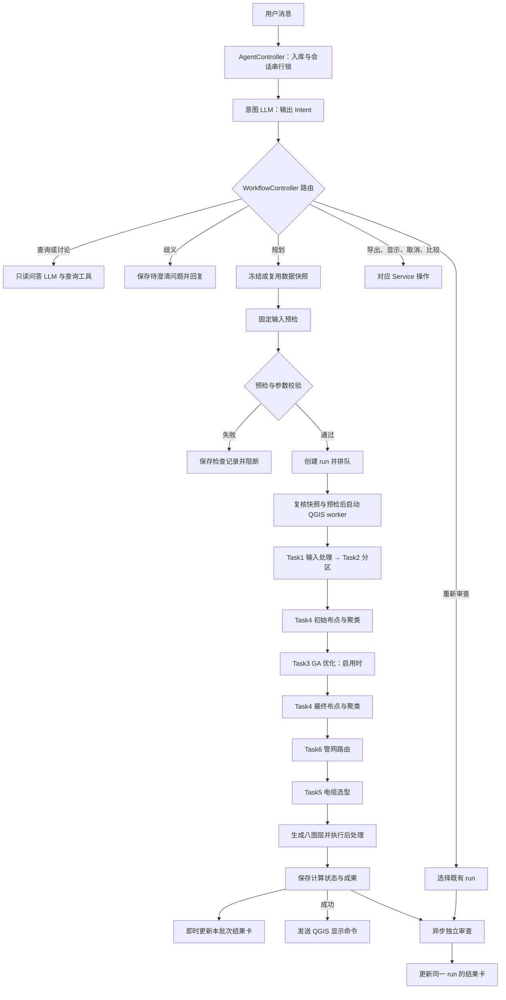
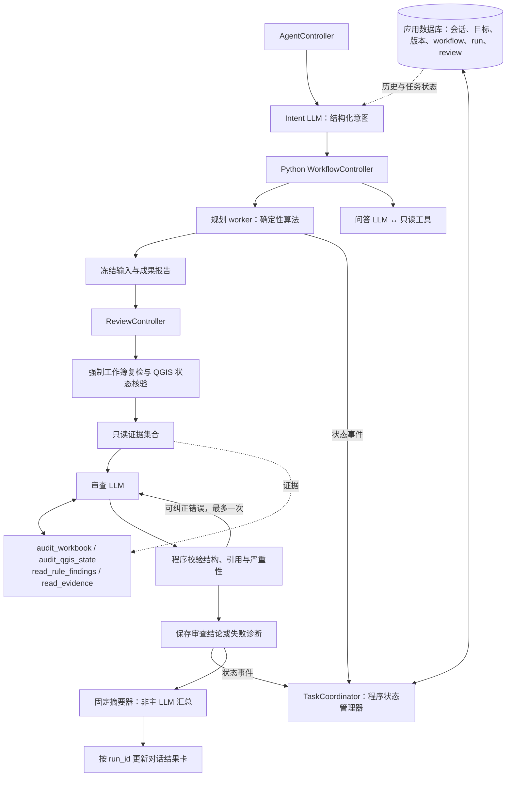

# 当前编排复核：规划与独立审查

日期：2026-09-27。针对当前工作目录代码；工作目录含尚未提交的修改。
运行：`run_f334c31c878f4e3e`；审查：`review_f45eacc0605d4222`。
本次只研究、读取实际成果与记录，未重跑规划、修改算法或降低检查标准。

## 结论

本次不是两个 LLM 丢失上下文导致的失败。确定性算法、成果适配器、后处理及独立规则检查存在不同的容量与几何口径。审查成功发现规则 7.2 违规；规则 6.2 的数值精度解释不足。编排层没有统一规则合同与冲突归因步骤，摘要层还会覆盖模型对确定性失败的解释。

当前“算法 agent”实际是意图模型与 Python WorkflowController 驱动的 QGIS worker；审查 agent 是只读工具调用模型。它们不是两个彼此通信、共同修正方案的自主 agent。

## 本地 CLI 源码与官方资料

本地副本在 `runtime/agent-research/`，版本来源为同目录 `sources.json`，本次没有更新这些研究副本。

| 来源 | 本地版本 | 实际查看的机制 | 本项目可借鉴之处 |
|---|---|---|---|
| Codex | e72da2b53805894878023d01949a25a082e0a5cb | `codex-rs/core/src/agent/control.rs` 的 completion watcher；`tools/handlers/multi_agents_v2/wait.rs` 的消息/活动等待 | 父子身份、终态通知、结构化结果回传；完成通知不等于业务验收通过 |
| Kimi CLI | 9ab1286b8fe4e6bcd116949a27ce5e0ac3389c82 | `src/kimi_cli/subagents/core.py` 的 prepare_soul；models.py；agent 实例独立 Context，按 agent_id 恢复 | 独立工作上下文、明确委派输入与可恢复身份，不依赖隐式共享模型记忆 |
| OpenCode | 696f41bc8e7586657375d53390925fc54c25d34c | `packages/opencode/src/tool/task.ts` 的 task_id、parentID、权限派生、错误回传和后台结果注入 | 工作者状态、任务结果与父任务继续处理明确分离 |

在线复核的官方资料：

- [Kimi Agents and Sub-Agents](https://moonshotai.github.io/kimi-code/en/customization/agents)
- [LangChain Subagents](https://docs.langchain.com/oss/python/langchain/multi-agent/subagents)
- [LangChain Router](https://docs.langchain.com/oss/python/langchain/multi-agent/router)

LangChain 明确区分单次意图路由与持续汇总子任务结果的 supervisor。当前系统更接近带持久任务状态的路由器 + 固定业务流水线；不是持续推理的 supervisor。CLI 的通用编排机制不会自动解决领域容量公式或几何容差问题。

## 已定位的原因

### 1. 7.2 的容量合同冲突：可由实际 DBF 复算

读取本批次最终 BOITE.dbf、CABLE.dbf，独立聚合结果：

| PM | PBO 已用纤数 | PBO 额定容量之和 | PM 出线容量 | 工作簿规则 7.2 |
|---|---:|---:|---:|---|
| ZPM_001 | 518 | 672 | 720 | 通过 |
| ZPM_002 | 500 | 648 | 576 | 不通过，缺 72 |

原规则位置：校验规则!A40:J40。它比较 PBO.CAPACITE 与以 PM 为 ORIGINE 的 DISTRIBUTION 电缆 CAPACITE，不是已用纤数。

执行链如下：

1. `vendor/ftth/engine/task5/task5_core.py:523` 用楼栋/PBO 需求聚合 downstream_ports；`:361` 用 max(下游需求, 直接下游设备容量) 选标准电缆。PM_002 四个 BPE 分别需求 142、114、122、122，设备容量均为 144，因此四条 PM→BPE 电缆均选 144，总计 576。这不是逐 PM 汇总下属 PBO 额定容量的约束。
2. `vendor/ftth/engine/build_final_layers.py:609` 在成果适配时计算 PBO 额定容量缺口，并直接给第一条出线补差额。CAB-00008 从 144 加到 216。
3. `vendor/ftth/final_layer_postprocessor.py:194` 限定标准规格 24/48/72/144，恢复 Task5 原始规格。本批次 `fields.cable_sizing_transfer.restored_adapter_overrides` 明确记录 CAB-00008 的 216→144。
4. 同文件 `:264` 把 `pm_capacity_violations` 改为 Task5 单链路 shortfall，并把 capacity_validation_basis 改为下游需求/设备容量。这个字段已经不是原先 PM 汇总容量检查的含义。
5. `backend/rule_checks.py:135` 按原工作簿重新聚合，得到 648>576，正确报告交付违规。

另有 `vendor/ftth/engine/delivery_validator.py:451` 使用 PBO 已用纤数校验出线容量。它主要用于交付导出等路径，不能把它误说成本次规划所有 PASS 的直接来源；但这是另一个需要统一的口径。

不能简单恢复 216 芯：它违反当前 Task5/后处理允许的规格集合。需要在正式规划模型中同时满足标准规格、路由/管道容量、PBO 额定容量覆盖等约束，再决定增缆、分配或规格策略。

### 2. 6.2 的精度政策不一致

- `vendor/ftth/engine/task2/znro_zpm_region_partition.py:1909` 对交叠应用数值面积容差；公式为 max(1e-18, 1e-15 × 最大绝对坐标²)。本批次原始分区坐标算出的阈值约为 1.1038736087881468e-12 平方坐标单位。
- `scripts/review_worker.py:87` 对最终成果使用 QGIS intersection，任何正面积即 fail。
- 最终成果交叠为 3.649641353020705e-14 平方坐标单位，椭球面积测量约 0.000380087 m²。
- 前后使用的几何表示和求交实现并不相同。最终测值小于 Task2 阈值，证明精度政策不一致；不能仅据此证明该交叠完全由浮点误差产生。
- `final_layer_postprocessor.py` 更换区域几何后，报告仍带 `source_region_non_overlap` 原始结果；它不是最终写盘几何的同一检查。

下一步应使用相同最终成果分别记录严格拓扑检查与数值精度诊断，明确 CRS/单位/规则版本，调查坐标舍入与几何转写阶段。工程容差未经确认不能自行放宽。

### 3. 失败项摘要来自固定代码替换

`backend/review.py:338` 的 Evidence.enforce 为确定性失败创建 mandatory Finding，再删除引用同一失败规则的模型 Finding。描述直接拼接 totals/measured_overlaps JSON，建议统一为“查看工具明细”。

这解释了两个现象：

- ZPM_001 通过，但与 ZPM_002 一起进入错误描述，因为 totals 包含全部对象。
- 即使模型作出更具体的归因，最终也可能被固定模板覆盖。

`backend/result_summary.py` 直接展示这些 findings，没有针对“算法内部 PASS / 工作簿 FAIL”进行冲突归因。主 LLM 也没有在审查结束时被重新唤起汇总。

保留程序裁定严重性和证据的权威是必要的；可把不可覆盖的规则事实与有证据支持的解释/建议分开存储，再统一渲染。

### 4. 编排层已具备的能力与缺口

已具备：TaskCoordinator 持久化目标/约束/版本；worker 绑定父任务与 run；迟到状态不能覆盖新目标；数据快照冻结；审查独立证据上下文；程序规则先行；审查只读；结果卡按 run_id 更新；没有自动重算。

缺口：任务合同没有统一的领域规则版本、容量口径、几何精度政策和验收谓词；规划成果经过多次改写后没有统一校验闭环；审查结果回传后只有模板总结，没有单独的冲突解释阶段。不得把这些缺口笼统描述为“没有传上下文”：审查 payload 已传 task_context 和运行证据。

## 当前实际 workflow

上图展开完整规划成功路径；仅分区规划会提前结束。GA 内部有自己的候选评估，不是 agent 自由循环。执行异常保存失败 run，仍可审查已存在的证据；取消/中断的运行跳过审查。

## 当前 agent 与状态流

没有审查→自动重新计算的边；没有两个 agent 自由互发消息的边。三个 LLM 节点是局部 create_agent 循环，外围为 Python 编排。

## 建议调整顺序（尚未实施）

1. 统一 RuleContract：规则版本、输入/成果阶段、适用范围、计量单位、容量口径和精度政策，随快照/run/review 冻结；让规划与审查使用同一规则来源。
2. 修复 7.2 的生成端约束，不在成果适配器里临时加芯，再由后处理撤回；所有写盘变换完成后重新检查完整规则。
3. 分开记录计算成功、规则执行状态、交付合规状态；对严格几何违规附精度诊断，不能偷偷按更宽标准变成通过。
4. 保留只读审查，增加有明确输入/输出的结论协调阶段：列出冲突规则、对象、计算依据、实际缺口和处理建议。可用固定事实结构加受约束 LLM 解释；不赋予自动重跑权限。
5. 用本批次固定成果建立合同回归：500≤576 与 648>576 必须同时正确解释；216→144 不得隐藏新违规；源几何与最终几何不得共用未经重验的 PASS；审查完成事件只能更新对应 run。

本次验证范围：本地三种 CLI 源码、官方文档、当前应用调用链、实际审查证据、最终 DBF 容量复算、Task2 阈值计算。未重新调用真实模型，未运行新规划，未对现有最终几何重新执行另一套 GIS 求交算法。
